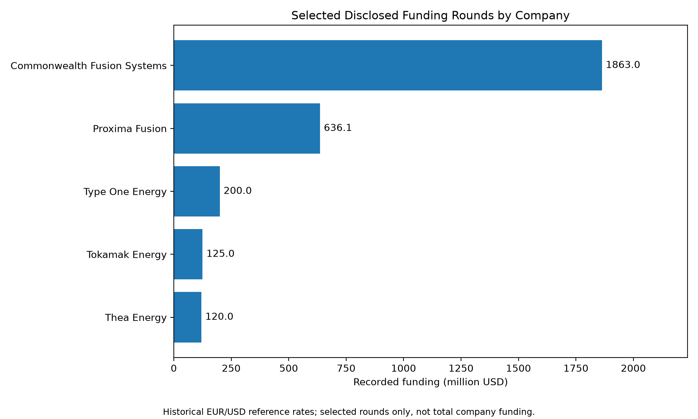
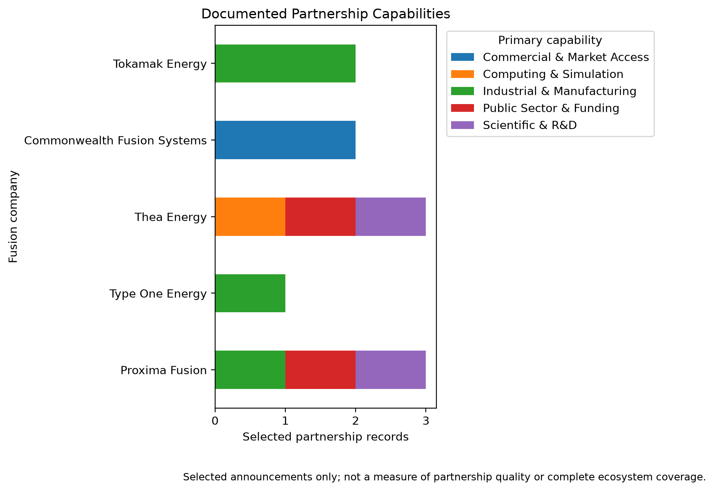

# The Economics of Commercial Fusion

### A Data-Driven Market and Strategic Analysis of Proxima Fusion

**Independent Research Project | Engineering Economics · Energy Strategy · Data Analytics**

## Overview

Commercial nuclear fusion has the potential to become a new source of low-carbon electricity. However, its economic competitiveness remains uncertain due to technological, manufacturing, financial, and commercialization challenges.

This independent research project investigates the emerging commercial fusion industry, using Proxima Fusion as its primary case study.

The research combines competitive intelligence, quantitative market analysis, engineering economics, and strategic decision modeling.

### Central Research Question

> Under which technological, economic, and market conditions can stellarator-based fusion become commercially competitive in Europe, and what strategic positioning should Proxima Fusion pursue?

## Research Objectives

1. Analyze the financing and competitive structure of the commercial fusion industry.
2. Benchmark Proxima Fusion against selected fusion technology companies.
3. Evaluate technological and manufacturing factors influencing commercial reactor economics.
4. Develop Python-based techno-economic models for commercial fusion power plants.
5. Quantify economic uncertainties and evaluate alternative commercialization strategies.

## Companies Under Investigation

- Proxima Fusion — Primary case study
- Type One Energy
- Thea Energy
- Commonwealth Fusion Systems
- Tokamak Energy

## Research Methodology

The project is organized into seven stages:

| Stage | Description | Status |
|---|---|---|
| 1 | Research Design & Hypotheses | Completed |
| 2 | Market Data & Financial Analysis | Descriptive baseline completed; scope limitations retained |
| 3 | Competitive Technology Benchmarking | Completed; evidence gaps documented |
| 4 | Techno-Economic Modeling | Completed; internally reconciled, assumption-driven analysis |
| 5 | Risk & Monte Carlo Simulation | Planned |
| 6 | Strategic Decision Modeling | Planned |
| 7 | Final Research Report & Dashboard | Planned |

### Research Hypotheses

- **H1 — Technology Economics:** Stellarator operating advantages may compensate for higher engineering complexity and capital costs.
- **H2 — Commercialization Strategy:** Industrial and utility partnerships may mitigate financing and commercialization risks.
- **H3 — Manufacturing Scalability:** Standardization and accumulated manufacturing experience may reduce reactor construction costs.

None of these hypotheses is considered empirically confirmed by the completed stages.

## Market and Strategic Research — Stages 1–2

### Financial Data Analysis

A structured dataset has been developed covering:

- Company characteristics
- Selected disclosed investment rounds
- Reported cumulative funding snapshots
- Strategic partnership announcements
- Source and evidence documentation

Python scripts have been implemented for data validation, funding aggregation, historical currency conversion, and comparative visualization.

### Strategic Partnership Analysis

Publicly documented strategic relationships have been classified by primary capability:

- Industrial and manufacturing
- Scientific research and development
- Computing and simulation
- Public-sector support
- Commercial and market access

The analysis is exploratory and does not represent a complete census of industry partnerships.

### German Electricity Market Baseline

The Stage 2 analysis includes hourly 2024 German/DE-LU wholesale electricity-market data, price distributions, and periods of negative prices.

Historical market observations inform revenue stress tests; they are not forecasts of the prices a future fusion plant will receive.

## Preliminary Research Outputs

### Selected Funding Rounds



*Selected publicly disclosed investment rounds, standardized into USD using historical reference rates. These totals do not represent complete company funding histories.*

### Strategic Partnership Capabilities



*Selected publicly announced partnerships, classified by primary strategic function. Counts do not measure partnership quality.*

## Engineering Benchmarking — Stage 3

Stage 3 compares selected fusion reactor concepts and their available technical evidence.

The analysis distinguishes experimental observations, simulated results, conceptual design values, and future commercial targets.

The engineering benchmarking examines:

- Stellarator and tokamak confinement trade-offs
- High-field superconducting magnet architecture
- Manufacturing complexity and structural requirements
- Maintenance schedules and simplified availability scenarios
- Technology maturity and evidence coverage
- Engineering parameters influencing CAPEX, OPEX, net electrical output, and plant utilization

The Stellaris maintenance analysis identifies how alternative maintenance assumptions influence theoretical plant availability. These calculations do not establish the actual net electrical capacity factor of a commercial power plant.

The comparison also evaluates different approaches to stellarator magnet engineering, including Proxima's non-planar modular magnets and Thea Energy's planar shaping-coil architecture.

### Stage 3 Research Conclusion

The research identifies potential operational advantages of stellarator confinement alongside important engineering and manufacturing challenges.

However, the available evidence does not establish that one reactor architecture has lower commercial electricity costs than another.

**Research synthesis:** `research/19_engineering_research_synthesis.md`

## Techno-Economic Modeling — Stage 4

Stage 4 develops a reproducible economic framework for investigating the conditions under which stellarator-based fusion electricity could become commercially competitive.

The analysis converts engineering characteristics and economic assumptions into quantitative electricity-cost and investment scenarios.

### Stage 4.1 — Baseline LCOE Model

A Python-based Levelized Cost of Energy model was developed and validated.

The simplified annualized formulation is:

\[
LCOE = \frac{CAPEX \cdot CRF + FOM}{P_{\mathrm{net}} \cdot 8760 \cdot CF} + VOM
\]

The model incorporates capital expenditure, fixed and variable operating costs, net electrical output, capacity factor, economic lifetime, and discount rate.

Automated validation checks confirm internal mathematical consistency.

### Stage 4.2 — Fusion Cost Benchmarking

Published fusion techno-economic research was reviewed to establish contextual cost benchmarks.

A separate set of provisional Stellaris economic scenarios was developed for sensitivity analysis.

The analysis distinguishes:

- Published literature estimates
- Company-reported technical specifications
- Analyst-defined economic scenarios
- Conditional model results

Published cost estimates for alternative reactor technologies are not directly interpreted as verified Stellaris costs.

### Stage 4.3 — Engineering Performance Sensitivity

A two-dimensional analysis investigates how capital intensity and net electrical capacity factor influence LCOE.

The analysis includes:

- CAPEX–capacity-factor sensitivity matrices
- Break-even capacity-factor calculations
- Maximum justifiable CAPEX under specified LCOE targets
- Separate net electrical output sensitivity

**Principal finding:** Higher operating performance can improve electricity cost competitiveness, but improvements in capacity factor alone cannot necessarily compensate for large capital-cost disadvantages.

This is a conditional economic relationship, not confirmation of H1 for Proxima Fusion.

### Stage 4.4 — Manufacturing Learning Analysis

A component-level manufacturing learning model examines the potential influence of repeated HTS magnet-system production.

The model separates magnet-system expenditure from the remaining plant CAPEX.

Learning rates of 0%, 10%, and 20% per cumulative production doubling were evaluated under hypothetical cost-share assumptions.

For an illustrative 25% initial magnet CAPEX share and 20% learning rate, four production doublings reduce total modeled plant CAPEX by approximately 14.76%.

These results illustrate the possible economic importance of standardization and production learning.

They do not establish actual manufacturing learning rates or verified cost reductions for Proxima Fusion.

### Stage 4.5 — Electricity Revenue and Project NPV

A discounted-cash-flow model was developed to assess electricity revenue and project investment economics.

The analysis includes:

- Historical German electricity-price stress testing
- Hypothetical fixed-price electricity-sale scenarios
- Annual project cash-flow schedules
- Net Present Value calculations
- Break-even electricity sale prices

The model distinguishes electricity production costs from project investment attractiveness.

Historical 2024 wholesale electricity prices are not treated as forecasts of future fusion electricity revenues.

### Stage 4.6 — Integrated Techno-Economic Assessment

The Stage 4 analyses were integrated through automated cross-model reconciliation checks.

The integration verifies consistency between:

- Stage 4.2 reference LCOE assumptions
- Stage 4.3 performance sensitivity
- Stage 4.4 manufacturing learning
- Stage 4.5 project NPV and break-even electricity prices

A passing integration audit demonstrates internal numerical consistency, not independent validation of commercial feasibility.

**Integrated research synthesis:** `research/25_stage4_techno_economic_synthesis.md`

### Stage 4 Reference Scenario

The principal illustrative economic reference case (`CAL002`) assumes:

| Parameter | Assumption |
|---|---:|
| Initial capital expenditure | EUR 12 billion |
| Net electrical output | 1,000 MWe |
| Capacity factor | 85% |
| Fixed annual OPEX | EUR 200 million |
| Variable OPEX | EUR 5/MWh |
| Economic lifetime | 35 years |
| Real discount rate | 8% |

Under these assumptions, the simplified model produces an LCOE of approximately **EUR 170.14/MWh**.

With compatible cash-flow boundaries and a constant real electricity sale price, this also represents the modeled break-even sale price at which NPV equals zero.

These figures are provisional analyst assumptions and conditional model outputs, not Proxima Fusion's verified construction costs, operating performance, or commercial electricity-price forecasts.

### Key Stage 4 Findings

The techno-economic framework identifies four major economic mechanisms:

1. **Capital-cost exposure:** Fusion power plant economics are highly sensitive to initial construction expenditure.
2. **Operational performance:** Higher net electrical generation can improve cost competitiveness, but its ability to compensate for higher CAPEX is limited.
3. **Manufacturing scalability:** Component-level learning can reduce total plant costs, depending on initial cost shares and achievable learning rates.
4. **Revenue realization:** Commercial attractiveness depends on electricity sale prices and investment returns, not solely on LCOE.

The analysis provides conditional quantitative findings but does not establish commercial superiority for Proxima Fusion or confirm H1–H3.

## Technical Stack

**Programming and Data Processing**

- Python
- Pandas
- NumPy

**Visualization**

- Matplotlib

**Research and Documentation**

- Git and GitHub
- Markdown
- CSV-based structured data
- Scientific and corporate source analysis

**Implemented Methods**

- LCOE and discounted cash-flow modeling
- Sensitivity and scenario analysis
- Break-even economic analysis
- Component-level manufacturing learning curves
- Automated model validation and integration audits

**Planned Methods**

- Monte Carlo simulation
- Global sensitivity analysis
- Correlated uncertainty and risk modeling
- Multi-criteria decision analysis

## Repository Structure

```text
fusion-energy-strategy-analysis/
├── data/               # Research datasets and economic scenarios
├── src/                # Python analysis and validation scripts
├── research/           # Research proposal, methods, and chapters
├── reports/            # Analytical figures, model outputs, and audits
├── notebooks/          # Exploratory analysis notebooks
├── README.md
├── requirements.txt
└── .gitignore
```

## Reproducing the Analysis

### 1. Open the downloaded or cloned project directory

```bash
cd fusion-energy-strategy-analysis
```

### 2. Create a virtual environment

```bash
python3 -m venv .venv
source .venv/bin/activate
```

### 3. Install dependencies

```bash
python -m pip install -r requirements.txt
```

### 4. Rebuild and review the Stage 1–2 baseline

```bash
python src/run_stage12.py
python src/check_stage12_closure.py
```

After dependencies have been installed, the rebuild uses retained inputs without network downloads.

It records package versions, file hashes, and results in `reports/stage12_run_summary.json`.

The closure command screens document consistency; scientific and editorial interpretation remains a separate review.

Optional download scripts are excluded from the offline rebuild.

### 5. Rebuild and review Stage 4

```bash
python src/lcoe_model.py
python src/validate_lcoe_model.py
python src/cost_calibration_analysis.py
python src/performance_sensitivity.py
python src/validate_performance_sensitivity.py
python src/manufacturing_learning.py
python src/validate_manufacturing_learning.py
python src/project_cash_flow.py
python src/validate_project_cash_flow.py
python src/plot_project_cash_flow.py
python src/integrate_stage4.py
```

The integration generates:

- `reports/stage4_integrated_summary.csv`
- `reports/stage4_integration_audit.json`
- `reports/stage4_integration_audit.md`

A passing audit establishes cross-model consistency under the stated assumptions. It does not provide independent commercial or technical verification.

## Research Documentation

- [Market Financing Analysis](research/03_market_financing_analysis.md)
- [Stage 1–2 Research Synthesis](research/11_stage12_synthesis.md)
- [Stage 1–2 Closing Review](research/14_stage12_final_review.md)
- [Stage 3 Engineering Synthesis](research/19_engineering_research_synthesis.md)
- [Stage 4 Techno-Economic Synthesis](research/25_stage4_techno_economic_synthesis.md)
- [Data Dictionary](research/06_data_dictionary.md)

The underlying datasets and their associated sources are documented in the `data/` directory.

## Limitations

This research uses publicly available disclosures, selected company announcements, scientific literature, and explicitly identified analyst assumptions.

Funding figures may differ in composition, reporting dates, and completeness.

Technological milestones announced by companies are not treated as independently verified outcomes unless supporting evidence is available.

Stage 4 economic scenarios are not company-reported construction or performance forecasts. The model does not yet establish verified Stellaris CAPEX, OPEX, net electrical capacity factor, or manufacturing learning rates.

The initial economic models simplify construction timing, financing, taxes, component replacement, decommissioning, and hourly electricity-market participation.

Historical electricity prices must not be interpreted as future revenue forecasts.

The analysis does not establish that Proxima Fusion will achieve commercial competitiveness or outperform alternative fusion technologies.

## Disclaimer

This is an independent educational research project.

It is not commissioned, sponsored, or endorsed by Proxima Fusion or any of the other companies discussed.

The research does not constitute investment advice.

## Baseline Scope and Handover

The enhanced Stage 1–2 baseline contains five companies, nine selected financing events, five historical snapshots, 11 partnership records, nine milestone observations, and a single-year 2024 DE/LU electricity analysis.

It is not a complete financing-history census.

Raw ECB input archival remains a documented reproducibility improvement.

See [the closing review](research/14_stage12_final_review.md).

Stage 3 established a structured engineering evidence baseline, and Stage 4 developed an integrated assumption-driven techno-economic framework.

H1–H3 remain open research hypotheses.

## Next Stage — Risk and Monte Carlo Simulation

Stage 5 will investigate how uncertain economic and engineering inputs jointly influence fusion electricity costs and project investment outcomes.

The analysis will focus on:

- Capital expenditure uncertainty
- Capacity factor and operational performance
- Fixed and variable operating expenses
- Manufacturing learning rates
- Discount rates and financing conditions
- Electricity sale-price uncertainty
- Dependencies and correlations between model parameters

Monte Carlo simulations will be used to explore distributions of LCOE and NPV outcomes, identify important risk drivers, and evaluate the robustness of conditional economic conclusions.

Where empirical evidence is insufficient, uncertainty distributions will be explicitly identified as exploratory analyst assumptions rather than objective probabilities of commercial success.

The results will provide the foundation for Stage 6, where alternative financing, industrial partnerships, and commercialization strategies will be evaluated.

**Current Research Status:** Stages 1–4 completed as structured, reproducible research workflows. Stage 5 — Uncertainty Analysis — is next.