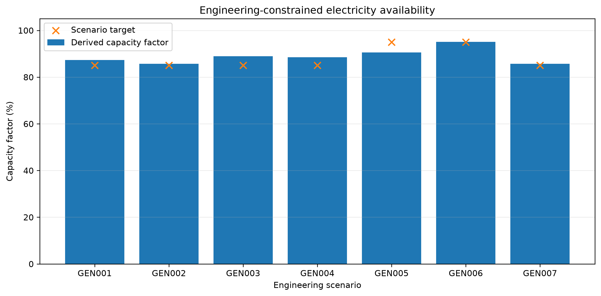
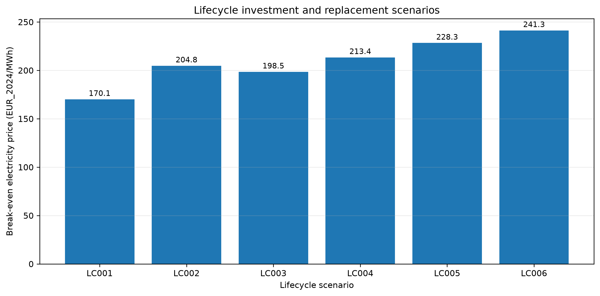
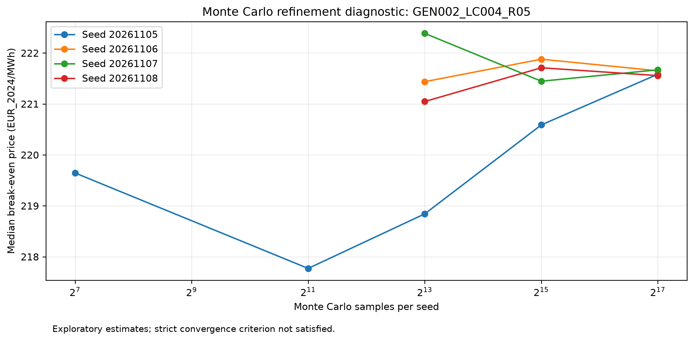
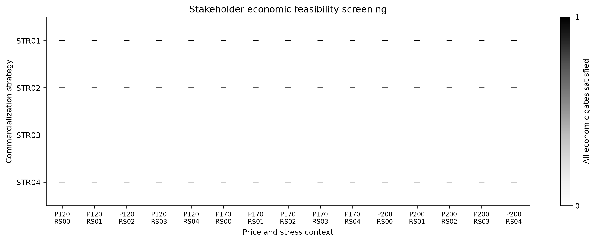

# The Economics of Commercial Stellarator Fusion

*An Integrated Techno-Economic, Uncertainty, and Commercialization Strategy Analysis*

## Abstract — Draft

The commercialization of nuclear fusion requires the simultaneous resolution of engineering, economic, financial, and organizational challenges. While stellarator configurations offer potential operational advantages, their commercial competitiveness depends on the relationship between plant capital intensity, net electricity generation, maintenance requirements, manufacturing scalability, and revenue realization.

This study develops an integrated analytical framework for examining these relationships, using Proxima Fusion's proposed stellarator power-plant architecture as a motivating case study. The research combines an evidence-based comparison of five fusion companies with engineering-constrained generation modeling, levelized cost of electricity (LCOE) analysis, discounted lifecycle cash flows, exploratory Monte Carlo uncertainty analysis, and comparative commercialization strategy modeling.

Under the illustrative reference assumptions, the simplified LCOE is approximately €170.14/MWh, while an extended lifecycle scenario incorporating construction timing and major component replacement produces a break-even electricity price of approximately €213.42/MWh. These values are conditional model outputs rather than empirically calibrated project forecasts.

The uncertainty analysis identifies sensitivity to economic assumptions but does not satisfy the study's strict convergence criterion. The strategic analysis examines integrated ownership, joint ventures, technology supply, and hybrid commercialization structures. None of the evaluated strategies satisfies all stakeholder economic feasibility gates across the 15 examined contexts.

The findings demonstrate the importance of jointly assessing engineering performance, capital investment, lifecycle expenditures, and stakeholder-level value allocation. The study provides a reproducible exploratory framework while distinguishing mathematical consistency from empirical validation and commercial bankability.

## 1. Introduction

### 1.1 Background and Motivation

The development of commercial nuclear fusion involves the transition from experimental plasma confinement and conceptual reactor designs toward integrated electricity-generating power plants. This transition requires progress not only in plasma physics but also in superconducting magnet systems, heat exhaust, structural engineering, maintenance architecture, and power-plant integration. The conceptual Stellaris design illustrates several of these engineering challenges within a proposed stellarator-based power-plant architecture [BPF03]. However, the successful integration of these subsystems into a commercially operating facility, together with the associated investment and electricity-generation economics, remains to be demonstrated.

Stellarator technology is particularly relevant to the development of commercial fusion energy. Recent conceptual reactor studies, including the Stellaris high-field quasi-isodynamic design, investigate the integration of plasma confinement, superconducting magnets, structural support, heat exhaust, and remote maintenance within a coherent power-plant architecture [BPF03]. However, these engineering studies do not establish demonstrated commercial availability or independently verified plant economics.

An assessment of commercial potential therefore cannot rely exclusively on plasma physics performance or nominal electrical output. It must also examine capital expenditure, operational availability, electricity production, replacement schedules, financing assumptions, and the distribution of risks and revenues among participating organizations.

### 1.2 Research Gap

Commercial fusion economics must account for the interaction between plant investment, operational performance, electricity generation, and cost recovery. Published fusion techno-economic studies provide useful external cost benchmarks, but their results depend on reactor architecture, plant scale, development maturity, and assumed financial conditions [EC001]. Accordingly, this research develops a common analytical framework connecting engineering-constrained generation, lifecycle economics, uncertainty analysis, and stakeholder-level commercialization strategies. This integration is a methodological objective of the present study, rather than a claim that previous literature has not investigated these relationships.

For example, a higher capacity factor can improve the recovery of fixed costs, but achieving greater availability may require additional investment in maintenance systems and components. Similarly, manufacturing learning can reduce selected subsystem costs without producing equivalent reductions in total plant expenditure.

Commercial arrangements further complicate these relationships. A technology supplier may face lower direct plant-investment exposure than an integrated owner-operator, but shifting capital responsibility to another stakeholder does not necessarily improve the underlying economics of the power plant.

This study therefore examines these mechanisms within a common analytical framework, while explicitly distinguishing empirical evidence from assumptions and model-derived results.

### 1.3 Research Question

**Under which technological, economic, and market conditions could stellarator-based fusion electricity become commercially competitive, and how do alternative commercialization structures influence the distribution of financial value and risk?**

The analysis is organized around three research hypotheses:

**H1 — Technology Economics:** Stellarator operating advantages may compensate for higher engineering complexity and capital costs.

**H2 — Commercialization Strategy:** Industrial and utility partnerships may mitigate financing and commercialization risks.

**H3 — Manufacturing Scalability:** Standardization and accumulated manufacturing experience may reduce reactor construction costs.

These hypotheses are treated as open research questions rather than confirmed propositions.

### 1.4 Research Contributions

This study makes four methodological contributions:

1. It links engineering-constrained electricity generation to economic cost and investment models rather than relying exclusively on unconstrained capacity-factor assumptions.
2. It incorporates construction timing, major component replacement, and manufacturing learning into a conditional lifecycle economic framework.
3. It examines parameter uncertainty and dependence assumptions while explicitly reporting convergence limitations and distinguishing exploratory simulations from empirically calibrated probabilities.
4. It compares alternative commercialization structures through stakeholder-specific cash flows, risk allocation, multi-criteria evaluation, and economic feasibility screening.

### 1.5 Scope and Interpretation

The analysis focuses on illustrative commercial fusion scenarios informed by publicly available technical and company information. Proxima Fusion serves as the motivating case study; the modeled results should not be interpreted as company-provided financial forecasts.

The study uses provisional engineering and economic assumptions, including a consistent real-price convention. It does not establish actual commercial construction costs, measured plant availability, validated fusion manufacturing learning rates, or executable financing agreements.

The distinction between reproducible calculations and externally validated commercial predictions is maintained throughout the research.

## 2. Research Methodology

### 2.1 Research Design and Analytical Framework

This study adopts an integrated computational research design combining publicly documented fusion-sector evidence with conditional engineering, economic, uncertainty, and commercialization models.

The analytical framework is organized into six interrelated layers:

1. Evidence collection and comparative industry analysis.
2. Engineering-constrained electricity generation.
3. Techno-economic and lifecycle investment modeling.
4. Manufacturing learning and cost scalability.
5. Exploratory uncertainty and sensitivity analysis.
6. Stakeholder-level commercialization strategy evaluation.

The purpose of integrating these layers is to examine how technical design assumptions propagate into financial outcomes and how alternative commercial arrangements distribute those outcomes among stakeholders.

The research distinguishes four categories of information: externally reported evidence, analyst-defined assumptions, model-derived calculations, and unresolved evidence requirements.

Model consistency and computational reproducibility are evaluated separately from empirical validation.

### 2.2 Data Collection and Evidence Classification

The study uses structured datasets describing five fusion companies: Proxima Fusion, Type One Energy, Thea Energy, Commonwealth Fusion Systems, and Tokamak Energy. Company-level observations and their associated evidence are maintained in the project's source and comparative registers (`data/sources.csv`, `data/competitive_sources.csv`, and `data/company_business_profiles.csv`). Company disclosures are treated as reported information rather than independent verification of technical or commercial performance.

The comparative framework covers eight categories: technology, product, customer, revenue, delivery model, manufacturing, maintenance, and development maturity.

Sources include company disclosures, published technical designs, selected research publications, institutional information, and historical electricity-market observations.

Each source is classified according to its evidentiary role. Company announcements are not treated as proof of commercial operation, and conceptual engineering targets are not interpreted as demonstrated performance.

Similarly, reported funding, partnerships, and future sales agreements are distinguished from realized project cash flows or independently verified financial returns.

The source comparison informs the construction of alternative analytical scenarios rather than providing direct empirical calibration for the modeled plant.

Published techno-economic research provides an external reference for understanding the range and sensitivity of projected fusion electricity costs. The ARAI tokamak cost study is included as contextual literature [EC001]. However, its reactor architecture, assumed development maturity, plant capacity, and cost basis differ from the hypothetical Stellaris scenarios examined here. Its published estimates are therefore not directly transferred into the model's capital-cost assumptions.

### 2.3 Engineering-Constrained Electricity Generation

Annual electricity generation is a central determinant of plant economics.

A simplified reference formulation is:

**E = P_net × 8,760 × CF**

where:

- E denotes annual net electricity generation in MWh.
- P_net denotes net-rated electrical capacity in MW.
- CF denotes the net capacity factor.

This expression is appropriate for constant annual utilization assumptions but does not explicitly represent the timing or duration of major maintenance events.

The engineering extension therefore evaluates generation under alternative maintenance intervals, major replacement outages, additional downtime, operating load factors, and auxiliary electricity consumption.

A simplified representation of the net-rating boundary is:

**P_net = P_gross × (1 − a)**

where a denotes the assumed proportional auxiliary-load fraction during operation.

The implemented engineering model distinguishes full-power-exposure maintenance intervals from calendar-based maintenance intervals. It also prevents scheduled downtime and capacity-factor deductions from being counted twice.

The resulting generation estimates are conditional on specified engineering inputs. They are not predictions of commercially achievable Stellaris availability.

The engineering scenario inputs are recorded in `data/engineering_generation_cases.csv`, while derived performance metrics are retained in `reports/engineering_generation_scenarios.csv`. Conceptual Stellaris design and maintenance discussions provide engineering context [BPF03], but the model's auxiliary-load assumptions, additional downtime fractions, and hypothetical outage modifications remain analyst-defined. Accordingly, the resulting capacity factors are conditional scenario outputs rather than verified plant performance estimates.

### 2.4 Levelized Cost of Electricity

The simplified economic framework uses the levelized cost of electricity to express the cost of generation over an assumed operating horizon.

For constant annual generation and operating expenditure, the reference formulation is:

**LCOE = (CAPEX × CRF + FOM) / E + VOM**

The capital recovery factor is defined as:

**CRF = r(1 + r)^N / [(1 + r)^N − 1]**

where:

- CAPEX represents initial capital investment.
- FOM represents annual fixed operating expenditure.
- VOM represents variable operating expenditure per MWh.
- E represents annual electricity generation.
- r represents the real discount rate.
- N represents the economic operating lifetime.

The annualized LCOE formulation and capital recovery factor follow established electricity-generation cost accounting conventions documented in the National Renewable Energy Laboratory's Annual Technology Baseline methodology [EC003]. The specific financial inputs used in this study remain analyst-defined assumptions rather than values validated by that methodological reference.

### 2.5 Discounted Lifecycle Cash-Flow Analysis

A discounted cash-flow model evaluates the relationship between investment expenditure, operating costs, electricity revenue, and project value.

The general net present value identity is:

**NPV = Σ [CF_t / (1 + r)^t]**

where CF_t denotes the net project cash flow occurring at time t.

The initial simplified model places capital investment at the beginning of the project and assumes constant annual operating conditions.

The extended lifecycle model introduces construction expenditure distributed over time, delayed revenue commencement, explicit major component replacement expenditure, and maintenance-related generation interruptions.

Construction spending precedes commercial generation. Replacement expenditure is charged at the modeled event time, while the corresponding interruption affects electricity output.

This timing-aware formulation permits comparison of scenarios involving construction schedules, maintenance strategies, replacement budgets, and commissioning delays.

A break-even electricity price is defined as the constant real sale price that produces zero project NPV under the specified assumptions.

This price should not be interpreted as a forecast of achievable electricity-market revenue or a financing commitment.

### 2.6 Manufacturing Learning and Capital-Cost Scalability

Manufacturing scalability is assessed using a component-level experience-curve formulation.

For a component with cumulative production increasing from Q_0 to Q, the illustrative cost relationship is:

**C(Q) = C_0 × (Q / Q_0)^b**

with:

**b = log₂(1 − LR)**

where LR denotes the assumed learning rate per doubling of cumulative production.

The model applies learning only to the designated learning-addressable component share of total plant expenditure.

The remaining expenditure is held constant within the simplified calculation.

This distinction prevents the cost reduction of one subsystem from being incorrectly applied to the full power plant.

Learning rates, manufacturing shares, production volumes, and industrial scale-up investments are treated as uncertain or provisional.

Consequently, the analysis tests the mathematical implications of learning assumptions without claiming an empirically established stellarator manufacturing learning curve.

### 2.7 Monte Carlo Uncertainty Analysis

The uncertainty framework examines how variation in selected financial and engineering assumptions affects project outcomes.

It distinguishes fixed engineering and lifecycle contexts from sampled economic parameters, avoiding the interpretation of all plausible scenario combinations as a single empirical probability distribution.

The implemented analysis uses documented pseudorandom seeds, specified sampling rules, sensitivity cases, and cross-seed comparisons.

Key economic uncertainties include capital expenditure, operating expenditure, discount rates, and electricity sale prices. Manufacturing-learning sensitivities are evaluated through their separately specified model structure.

Simulation results are summarized using selected distributional indicators and break-even measures.

Numerical convergence is assessed using the prescribed refinement and comparison criteria rather than inferred from the completion of a large simulation alone.

The strict multistage convergence criterion was not satisfied in the retained assessment. Cross-seed exploratory checks therefore do not establish full numerical convergence or real-world predictive probabilities.

The uncertainty results are interpreted as conditional sensitivity evidence, not statistically calibrated forecasts of commercial outcomes.

### 2.8 Commercialization Strategy Modeling

Four hypothetical commercialization structures are evaluated:

- STR01: Integrated plant ownership.
- STR02: Joint-venture ownership.
- STR03: Technology supplier or OEM structure.
- STR04: Hybrid ownership and supply arrangement.

These structures are analyst-defined alternatives rather than confirmed contractual arrangements adopted by Proxima Fusion.

The evaluation separates plant-level project value from the financial value retained by the modeled technology company and external project participants.

Stakeholder-level cash flows are reconciled to the corresponding modeled economic boundaries.

The strategy framework combines contractual value-allocation scenarios, risk-transfer stress tests, provisional multi-criteria decision analysis, and economic feasibility screening.

A strategy is considered economically eligible within the exploratory screening only when its defined company, external stakeholder where applicable, and overall project NPV conditions are satisfied.

The multi-criteria evaluation examines capital retention, company-level financial value, construction exposure, and revenue-risk exposure under alternative preference weights.

These results describe the consequences of assumed allocation rules and preferences. They do not independently validate financing terms, bankability, or a definitive commercialization strategy.

### 2.9 Computational Validation and Reproducibility

The research is implemented in Python, with structured CSV and JSON inputs, model scripts, automated validators, unit tests, and recorded analytical outputs.

Validation includes numerical identity checks, input-range restrictions, scenario coverage, selected independent calculations, financial reconciliation, source-file hashes, and regression tests designed to detect stale results.

A separate Git checkout and isolated Python environment are used to evaluate whether committed source files support the published validation workflow.

Passing unit tests and regeneration checks provides evidence of computational consistency under the supplied assumptions.

Such checks do not establish empirical calibration, the completeness of external source review, or the scientific validity of every modeling simplification.

The committed repository was evaluated in a separate Git checkout using an isolated Python environment. All 160 unit tests and five Stage 6 validation scripts passed in that environment. A separate Stage 7.1 inventory audit verified the presence of required repository files. These results support code-level reproducibility and internal consistency, but they do not constitute independent technical validation, empirical economic calibration, or confirmation of commercial feasibility.

### 2.10 Methodological Boundaries

Several limitations are retained throughout the analysis.

The modeled capital and operating expenditures are not verified commercial Stellaris budgets. Maintenance and generation inputs contain conceptual targets and analyst-defined extensions. Manufacturing learning parameters have not been calibrated to realized industrial production.

The economic framework excludes several mechanisms relevant to commercial financing and operation, including detailed debt financing, taxation, decommissioning obligations, offline electricity purchases, and hourly electricity-price capture.

The strategic models employ hypothetical contractual allocations rather than actual financing or supplier agreements.

Accordingly, this study provides a reproducible exploratory decision framework rather than a commercial plant valuation, investment recommendation, or empirical demonstration of fusion-electricity competitiveness.

## 3. Results

### 3.1 Overview of the Analytical Results

The integrated framework produces conditional findings across plant-level electricity economics, manufacturing scalability, uncertainty propagation, and stakeholder-level commercialization.

The results are interpreted within the defined engineering, financial, and contractual scenario boundaries. They do not represent observed financial performance or verified cost estimates for Proxima Fusion.

### 3.2 Reference Electricity Economics

Under the simplified reference assumptions, the annualized economic model yields a levelized cost of electricity of approximately **€170.14/MWh** in constant 2024 euros (author's calculations; `reports/stage4_integrated_summary.csv`). This result is derived from the project's analyst-defined reference parameters and should not be interpreted as an empirically calibrated electricity-generation cost for Proxima Fusion.

The corresponding simplified discounted cash-flow model produces an equivalent break-even electricity price when evaluated using matched assumptions for investment timing, operating expenditures, electricity generation, and discounting.

This agreement is an internal mathematical reconciliation between the two model formulations rather than independent empirical confirmation of the assumed costs.

The reference scenario demonstrates the importance of capital intensity, electricity generation, and discounting in determining cost recovery.

### 3.3 Engineering Availability and Lifecycle Effects

Engineering-constrained generation scenarios demonstrate that theoretical capacity-factor improvements cannot be evaluated independently of outage schedules, maintenance intervals, auxiliary loads, and operating power.

The modeled maintenance schedules limit achievable generation even before additional unplanned losses are included.

In the retained engineering analysis, the nominal 95% capacity-factor target is not achieved under the idealized five-month maintenance scenario with a four-full-power-year operating interval.

A hypothetical reduction of the major maintenance outage to two months permits the modeled target to be reached under the specified additional assumptions. This constitutes a sensitivity result, not evidence that the shorter maintenance period is technically achievable.

*Figure 1. Engineering-constrained capacity factors and scenario targets across seven illustrative configurations. Derived performance is conditional on maintenance schedules, operating loads, and auxiliary electricity consumption.*

In the extended lifecycle model, construction expenditure and major component replacement costs materially change the break-even electricity price.

The illustrative LC004 lifecycle scenario, incorporating a five-year construction schedule and €600 million per major replacement event, produces a modeled break-even electricity price of **€213.42/MWh** in constant 2024 euros (author's calculations; `reports/lifecycle_summary.csv`). This result reflects the specified construction, electricity-generation, replacement-cost, and discounting assumptions. It is not an empirically validated commercial electricity price for Proxima Fusion.

The six lifecycle scenarios produce the following results:

| Scenario | Break-even price (EUR_2024/MWh) |
|---|---:|
| LC001 | 170.14 |
| LC002 | 204.79 |
| LC003 | 198.51 |
| LC004 | 213.42 |
| LC005 | 228.32 |
| LC006 | 241.29 |

*Figure 2. Modeled break-even electricity prices across six lifecycle scenarios, expressed in constant 2024 EUR/MWh. Scenarios differ in construction timing, electricity-generation treatment, replacement expenditure, or commissioning delays.*

These results demonstrate that lifecycle timing and replacement assumptions influence project cost recovery. However, differences between scenarios must be interpreted according to their specific model boundaries. In particular, LC002 and LC003 do not isolate construction costs because their generation assumptions also differ.

### 3.4 Manufacturing Learning and Cost Scalability

The component-learning model demonstrates how manufacturing experience may affect total power-plant capital expenditure.

Under the illustrative assumptions of a 25% learning-addressable magnet-system CAPEX share and a 20% component learning rate, four doublings of cumulative production reduce total modeled plant capital expenditure by approximately **14.76%**, from €12 billion to €10.23 billion (author's calculations; `reports/stage44_learning_results.csv`). The calculation applies learning exclusively to the designated component share and excludes additional industrial scale-up expenditure. It therefore does not establish an empirically achievable cost-reduction trajectory.

The modeled reference capital expenditure of €12 billion decreases to approximately €10.23 billion under these assumptions.

The result highlights that subsystem learning does not produce an equivalent percentage reduction in whole-plant costs.

It also depends on the assumed production sequence, cost allocation, and exclusion of additional industrial scale-up expenditure.

Consequently, the result supports the conditional economic mechanism underlying H3 without establishing an empirically achievable manufacturing trajectory.

### 3.5 Uncertainty and Numerical Convergence

The Monte Carlo framework examines the propagation of exploratory economic uncertainty across predefined engineering and lifecycle contexts. Numerical behavior is assessed through nested sample-size refinements and multiple independent pseudorandom seeds.

The initial Stage 5.3 convergence audit reports `NONCONVERGED`, with 74 failed refinement tests. The extended assessment, incorporating sample sizes up to 131,072 per seed, also reports `NONCONVERGED`, with 17 failed refinement tests. Both assessments require two consecutive successful refinements under their prescribed criteria.

*Figure 3. Median modeled break-even electricity price for the GEN002_LC004_R05 context under increasing Monte Carlo sample sizes and alternative pseudorandom seeds. Visual stability of a selected statistic does not establish satisfaction of the full convergence criteria.*

The Stage 5.5 integration audit records the status `COMPLETE_EXPLORATORY_CROSS_SEED_SUMMARY_NOT_CONVERGENCE_CERTIFIED`. Accordingly, successful production of cross-seed summaries should be distinguished from certified numerical convergence.

The retained simulation results remain useful for exploratory comparisons and identifying model sensitivities. However, they do not establish reliable empirical probabilities of commercial success. The engineering contexts are not probability-weighted, and the assumed input distributions are not independently calibrated to realized commercial stellarator projects.

The numerical findings are therefore interpreted as conditional exploratory evidence, with convergence and empirical calibration remaining open research limitations.

### 3.6 Commercialization Strategy Evaluation

Four hypothetical commercialization structures were evaluated:

- **STR01:** Integrated plant ownership.
- **STR02:** Joint-venture ownership.
- **STR03:** Technology supplier or OEM structure.
- **STR04:** Hybrid ownership and supply arrangement.

The strategy framework compares stakeholder-level value allocation, construction-risk exposure, revenue-risk exposure, and alternative multi-criteria weighting policies.

The provisional multi-criteria decision analysis compares four commercialization structures under alternative weighting policies and scenario contexts. Relative performance depends on the selected criteria, preference weights, and financial assumptions. The MCDA outputs are therefore interpreted as conditional preference-based comparisons rather than evidence of a universally superior commercialization strategy. Economic eligibility is evaluated separately through stakeholder-level feasibility screening.

However, preference-based rankings must be distinguished from economic feasibility.

In the subsequent economic screening, **none of the 60 strategy-context combinations satisfies all applicable company, external-stakeholder, and project-level economic gates**.

*Figure 4. Economic feasibility screening across four commercialization structures and 15 modeled contexts. All 60 combinations fail at least one of the applicable economic feasibility conditions. The result applies only to the selected analytical scenarios and assumptions.*

Across the 15 examined contexts, no strategy is simultaneously eligible under the defined economic conditions.

These findings do not establish that a particular commercialization structure is universally infeasible. They show that the modeled allocation of value and risk does not resolve the economic constraints within the examined assumptions.

### 3.7 Integrated Interpretation

Three findings emerge from the combined analysis.

First, the economic value of improved operating performance depends on the associated engineering costs and maintenance conditions.

Second, reducing a particular capital-cost component can improve project economics without necessarily overcoming the total investment burden.

Third, transferring capital responsibility and contractual risk among stakeholders does not automatically create positive economic value at the overall project level.

Taken together, the results support an integrated approach to fusion commercialization in which engineering performance, investment economics, manufacturing requirements, and stakeholder incentives are evaluated jointly.

The research hypotheses remain open because the analysis establishes conditional mechanisms and internal model consistency rather than externally verified commercial outcomes.

## 4. Discussion

### 4.1 Technology Economics — H1

The results demonstrate that technical operating performance and electricity-generation economics are strongly interconnected. Under the modeled assumptions, greater annual generation improves the recovery of fixed capital and operating expenditures.

However, the engineering-constrained scenarios indicate that high nominal capacity factors cannot be assessed independently of maintenance schedules, outage durations, auxiliary consumption, and operating loads.

The lifecycle findings further show that construction timing and major replacement expenditure can substantially alter project economics.

These mechanisms are consistent with the economic rationale underlying H1. Nevertheless, the results do not establish that the operational advantages of an actual stellarator power plant compensate for its engineering complexity or capital costs.

**H1 status: Open.**

### 4.2 Manufacturing Scalability — H3

The component-level learning analysis demonstrates that repeated production may reduce selected capital-cost categories under assumed learning rates.

However, the reduction in total plant expenditure depends on the fraction of costs affected by manufacturing learning.

For the illustrative reference parameters, a 20% subsystem learning rate over four production doublings produces a 14.76% reduction in total modeled plant CAPEX.

This finding establishes a conditional economic relationship, but it does not demonstrate that the assumed learning rate, production scale, or capital-cost allocation will be achieved.

**H3 status: Open.**

### 4.3 Commercialization Strategy — H2

The strategic results distinguish the allocation of financial value and risk from the creation of economic value at the project level.

Technology-supplier and hybrid arrangements may reduce the direct investment responsibilities retained by the technology company, depending on contractual assumptions.

However, transferring capital expenditure and project risks to utilities, investors, or industrial partners does not by itself eliminate the economic obligations of the underlying power plant.

The economic screening finds that none of the 60 evaluated strategy-context combinations satisfies the full set of modeled financial feasibility conditions. The retained feasibility screen records no fully eligible combinations among the 60 evaluated strategy-context cases (`reports/stage65_feasibility_screen.csv`). This finding is specific to the defined economic gates and scenario assumptions and should not be interpreted as evidence that all possible commercial fusion arrangements are economically infeasible.

This outcome highlights a distinction between favorable strategic attributes and financially eligible projects under the selected assumptions.

The analysis does not provide causal evidence that partnerships reduce real-world financing costs or commercialization risk.

**H2 status: Open.**

### 4.4 Uncertainty and Decision Robustness

The uncertainty analysis illustrates the importance of evaluating multiple engineering and economic assumptions rather than relying exclusively on a deterministic reference case.

However, the strict multistage convergence criterion was not satisfied.

Consequently, the retained distributional results should not be interpreted as numerically certified probability estimates.

Likewise, the assigned probability distributions are exploratory and are not supported by sufficient empirical data to represent objectively known commercial outcome probabilities.

The analysis is therefore most useful for identifying conditional sensitivities, model dependencies, and research priorities.

### 4.5 Implications for Fusion Commercialization

The integrated analysis identifies several requirements for improving the assessment of commercial stellarator fusion.

Economic performance must be examined using realistic electricity-generation constraints, explicit major maintenance and replacement schedules, and time-consistent investment modeling.

Manufacturing improvements should be evaluated at the component level while accounting for remaining plant expenditure and industrial scale-up requirements.

Commercialization structures should be compared using stakeholder-level economics rather than technology-company capital exposure alone.

The most important implication is methodological: favorable engineering assumptions, cost-reduction pathways, and contractual risk allocation must be evaluated jointly to understand whether they produce an economically viable project.

## 5. Research Limitations

The principal limitations of the study concern empirical calibration, engineering uncertainty, financial-model boundaries, and numerical convergence.

The modeled plant is not an independently verified commercial reactor design. Capital costs, operating expenditures, and manufacturing-learning parameters are based on provisional assumptions rather than realized Stellarator project accounts.

Maintenance assumptions and availability scenarios do not constitute independently demonstrated commercial performance.

The lifecycle financial model omits detailed debt financing, taxation, decommissioning liabilities, hourly electricity-market capture, and several other factors relevant to real investment decisions.

The Monte Carlo model uses exploratory probability distributions, and its strict convergence criterion has not been satisfied.

The strategic alternatives rely on hypothetical contractual and value-allocation assumptions rather than executable agreements between actual commercial counterparties.

Finally, the study does not provide a complete census of the fusion industry or an independent verification of all company-reported technical and financial claims.

These limitations restrict the interpretation of the results to conditional analytical findings rather than empirically validated commercial forecasts.

## 6. Conclusion

This research develops an integrated analytical framework for investigating the engineering, economic, uncertainty, and commercialization challenges facing stellarator-based fusion electricity.

The simplified reference model produces a conditional LCOE of approximately €170.14/MWh, while a lifecycle scenario incorporating construction timing and major component replacement yields a break-even price of approximately €213.42/MWh.

Manufacturing-learning analysis demonstrates that subsystem cost improvements do not translate proportionally into total plant cost reductions.

The uncertainty analysis highlights the sensitivity of financial outcomes to model assumptions but does not satisfy the strict numerical convergence criterion.

The commercialization analysis evaluates four alternative structures and finds no fully economically eligible strategy-context combination within the 60 examined cases.

Together, these findings demonstrate that operating performance, capital investment, lifecycle expenditures, manufacturing requirements, and stakeholder incentives must be evaluated as interconnected determinants of commercial feasibility.

The study does not establish the future commercial competitiveness of Proxima Fusion or validate a particular financing strategy.

Instead, its principal contribution is a computationally reproducible, evidence-bounded framework for identifying economic constraints, examining strategic trade-offs, and prioritizing future empirical research.

Future work should focus on externally calibrated engineering and cost assumptions, expanded financing and electricity-market models, improved uncertainty diagnostics, and independently verified industrial evidence.

## 7. References and Data Availability

The study draws on peer-reviewed technical literature,
energy-system cost methodologies, public company disclosures,
and reproducible computational model outputs.

The reference inventory, bibliographic review status,
and source identifiers are documented in
[the accompanying references file](references.md).

The analytical results are derived from the project's
structured inputs and Python implementations. The
corresponding source-to-result relationships are recorded
in [the citation map](citation_map.md).

The numerical outputs represent conditional scenario
calculations, not independently validated commercial
reactor forecasts.
