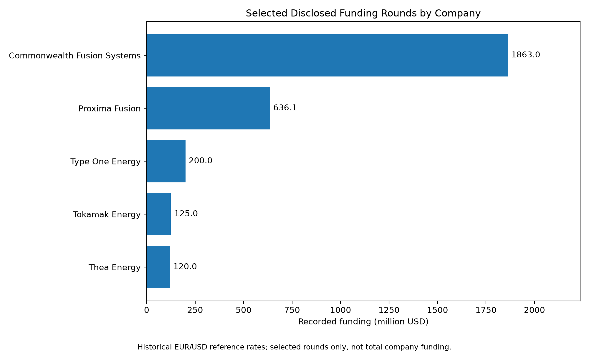
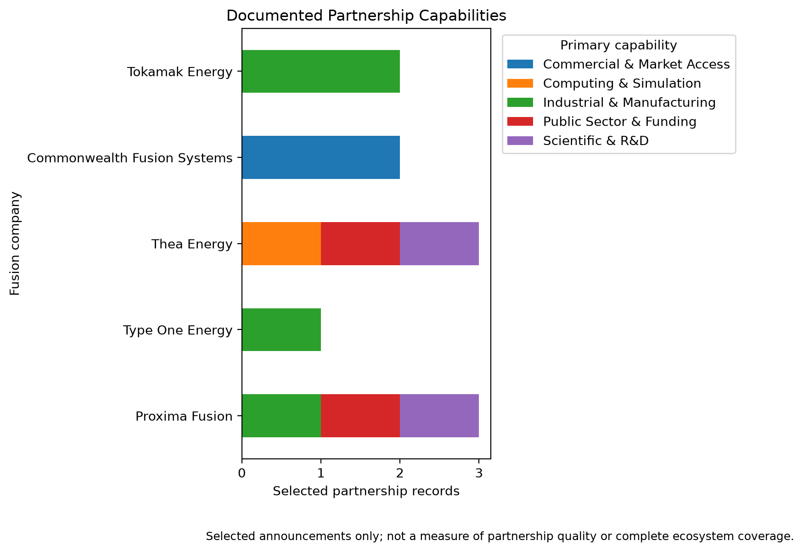

# 2. Fusion Industry Financing and Competitive Positioning

*The Economics of Commercial Fusion — Independent Research Project*  
*Chapter version 0.3 | Disclosure cutoff: 24 October 2026 | Review updated: 28 October 2026*

## 2.1 Industry Financing Landscape

Commercial fusion requires capital for fundamental research, reactor design, magnets and other critical components, demonstration facilities, manufacturing scale-up, and potentially first-of-a-kind (FOAK) power plants. As grid-scale commercial fusion has not yet established a replicable operating and cost record, investors face substantial technological, construction, regulatory, and market uncertainty.

Financing mechanisms serve different purposes. Equity finances the company in exchange for ownership; government grants can support specific R&D or infrastructure activities; industrial partnerships may contribute expertise, supply-chain capacity, or facilities; and power purchase agreements (PPAs) may create conditional future revenue commitments. A PPA is not equivalent to cash already received, while a project budget is not equivalent to secured financing.

This chapter examines five selected companies: Proxima Fusion, Type One Energy, Thea Energy, Commonwealth Fusion Systems (CFS), and Tokamak Energy. Its purpose is to establish a preliminary financial and partnership baseline for subsequent techno-economic analysis, not to rank their likelihood of technical success.

## 2.2 Competitive Funding Benchmark

The dataset distinguishes **individual funding events** (`funding_rounds.csv`) from **reported cumulative funding snapshots** (`funding_snapshots.csv`). These two measures must never be summed together. The snapshot figures also cover different reporting dates and financing definitions.

**Table 2.1 — Reported cumulative funding snapshots (original currencies)**

| Company | Reference date | Reported amount (millions) | Currency | Funding definition | Qualifier | Evidence status |
|---|---|---:|---|---|---|---|
| Proxima Fusion | 2026-07-07 | 650 | EUR | Mixed public and private funding | **More than** 650 (lower bound) | Company source checked |
| Commonwealth Fusion Systems | 2026-07-30 | 4,000 | USD | Company-reported cumulative capital raised | Approximate / rounded | Company source checked |
| Type One Energy | 2026-10-06 | 400 | USD | Reported cumulative funding | **More than** 400 (lower bound) | External report checked |
| Thea Energy | 2026-05-27 | 130 | USD | Reported cumulative private investment | Reported amount | External report checked |
| Tokamak Energy | 2024-11-20 | 335 | USD | $275M private + $60M government | Reported amount | Company source checked |

Proxima Fusion's dated announcement of 7 July 2026 reports more than €650 million in secured public and private funding, including €95 million in public grants. The figure is a company-reported lower bound, not an exact total or a measure of private equity funding alone. [Source: Proxima Fusion, 7 July 2026](https://www.proximafusion.com/press-news/proxima-fusion-raises-eu411-million-to-build-europes-commercial-fusion-champion).

**Sources:** [Proxima Fusion, 7 July 2026](https://www.proximafusion.com/press-news/proxima-fusion-raises-eu411-million-to-build-europes-commercial-fusion-champion); [CFS, 30 July 2026](https://cfs.energy/news-and-media/commonwealth-fusion-systems-raises-another-1-billion-bringing-total-capital-raised-to-4-billion/); [Reuters on Type One Energy, 6 October 2026](https://www.ksl.com/article/51632922/fusion-firm-type-one-in-200-million-siemens-energy-backed-raise); [TechCrunch on Thea Energy, 27 May 2026](https://techcrunch.com/2026/05/27/with-a-new-100m-raise-princetons-thea-energy-is-now-a-top-funded-fusion-startup/); [Tokamak Energy, 20 November 2024](https://tokamakenergy.com/2024/11/20/tokamak-energy-raises-125m-to-commercialise-transformative-fusion-and-magnet-technologies/).

CFS reports the largest cumulative amount in this selected sample, but the reported totals **do not constitute a like-for-like ranking of private financing**. The figures differ in currency, vintage, scope, and the inclusion of public support. Thea Energy also announced a subsequent Series B extension in August 2026 without disclosing its size; the May 2026 figure should therefore be treated as a historical snapshot, not a confirmed present-day total. [Thea Energy press releases](https://thea.energy/media-press/).

Capital raised should not be interpreted as capital efficiency, project cash availability, or likelihood of commercial success. Assessing capital efficiency would require verified expenditures, project scope, independently observed technical milestones, and a consistent maturity framework.

**Figure 2.1 — Selected disclosed funding rounds, converted to USD**

*Source: Author's calculations from selected publicly disclosed funding events in `data/funding_rounds.csv`, joined to historical ECB EUR/USD reference rates in `data/funding_normalized.csv`. The chart aggregates **only the rounds entered into the dataset**, not complete company funding histories. Coverage periods differ across companies. Currency conversion uses announcement-date reference rates and does not imply actual transaction exchange rates. This figure should not be used to rank cumulative financing strength.*

## 2.3 Strategic Partnership Ecosystems

Fusion companies use partnerships to access capabilities that are difficult to develop entirely in-house. In the documented sample, these include industrial manufacturing, scientific R&D, computational infrastructure, public-sector support, and prospective electricity customers.

Proxima's relationships with RWE and the Max Planck Institute for Plasma Physics illustrate the combination of utility-sector expertise and plasma-science capabilities. RWE also disclosed a €25M equity investment in Proxima; this investment forms part of an announced company financing round and must **not** be counted as an additional independent round. [Proxima financing announcement, 7 July 2026](https://proximafusion.com/press-news/proxima-fusion-raises-eu411-million-to-build-europes-commercial-fusion-champion).

The selected CFS records include forward-looking electricity offtake arrangements; Tokamak Energy's records highlight superconducting-magnet technology and industrial supply relationships; Thea Energy's records include research and computational collaborations. These categories represent different strategic functions rather than interchangeable financing amounts.

**Figure 2.2 — Strategic partnership capability mapping**

*Source: Author's classification of **11 selected partnership records** in `data/strategic_partnerships.csv`. Each record is assigned one primary capability in `src/partnership_capabilities.py`. The selection is not a comprehensive partnership census; a zero means “not recorded in this sample,” not “the capability is absent.” Counts do not indicate contract value, partnership quality, technological impact, or realized commercial outcomes.*

The figure can identify **questions for further investigation**, but it cannot establish whether one company has a stronger partnership ecosystem. A commercial PPA, research collaboration, equity investment, and conditional public co-financing arrangement carry different risks and rights. Reported contract values or power capacities must never be added to equity funding totals.

## 2.4 Preliminary Implications for Proxima Fusion

The evidence suggests that partnerships are already a significant element of Proxima's development approach. However, the present dataset **does not demonstrate** that those partnerships reduce the company's capital requirements, development time, or execution risk relative to alternatives.

Three hypotheses will guide subsequent analysis:

**H2-A — Risk sharing through utilities.** Collaboration with an established utility could lower the risks borne directly by Proxima by allocating certain engineering, infrastructure, licensing, and operational responsibilities to an experienced partner. This requires examination of actual contractual responsibility, capital commitments, and contingent liabilities.

**H2-B — Customer commitments.** Early electricity offtake agreements could improve revenue visibility and the financeability of a future plant, provided counterparties accept the conditions and lenders regard the contracts as bankable. Competitors' offtake announcements are useful reference cases, not proof of financing benefits for Proxima.

**H2-C — Integration versus specialization.** Proxima's integrated power-plant strategy could strengthen control over system design and intellectual property, but may also increase capital intensity and execution complexity. Technology supply, licensing, and joint-venture structures should be compared under explicit assumptions rather than judged from funding totals.

These propositions remain **untested strategic hypotheses**. Stage 3 will assess technology readiness, reactor architecture, magnets, and manufacturing constraints. Stage 4 will translate technical parameters into CAPEX, OPEX, availability, and LCOE scenarios. Later decision analysis will compare business models under financial and technical uncertainty.

## 2.5 Methodological Limitations

1. **Selection bias:** Only five firms and a curated set of announcements are included; findings are not representative of all fusion companies.
2. **Inconsistent financial definitions:** Company funding, public grants, project budgets, conditional contributions, and PPAs are distinct categories.
3. **Incomplete funding histories:** `funding_rounds.csv` contains selected events. Aggregations are not historical company totals.
4. **Different reporting dates:** Older snapshots, particularly Tokamak Energy's 2024 figure, must not be presented as current totals. An undisclosed subsequent investment may also make a snapshot incomplete.
5. **Source quality:** Some amounts are company-reported; external media confirmation is not an independent audit of financial statements. Source IDs and verification notes are maintained in `data/sources.csv` and `research/04_source_verification.md`.
6. **Partnership coverage:** Recorded relationships are examples, not a census. Counts are not equivalent to commercial impact.
7. **No causal inference:** The present analysis cannot establish that financing structure or partnerships cause superior engineering or financial outcomes.

The findings in this chapter are therefore **descriptive and hypothesis-generating**. Numerical models and strategic recommendations will require additional technical evidence and transparent scenario assumptions.

## References and Reproducibility

Primary data, provenance and analysis scripts are retained in:

- `data/funding_rounds.csv`, `data/funding_snapshots.csv`, `data/sources.csv`
- `data/strategic_partnerships.csv`, `data/partnership_capability_matrix.csv`
- `research/04_source_verification.md`
- `src/funding_comparison.py`, `src/partnership_capabilities.py`, `src/research_summary.py`

The source links supporting Table 2.1 are provided immediately below the table. Further partnership citations are tracked by `source_id` in the dataset. Conclusions should be revised when new disclosures or independently verified technical milestones become available.

*Baseline status: Version 0.3 — selected-record source review updated; incomplete histories, public/private comparability and undisclosed terms remain explicit limits.*
