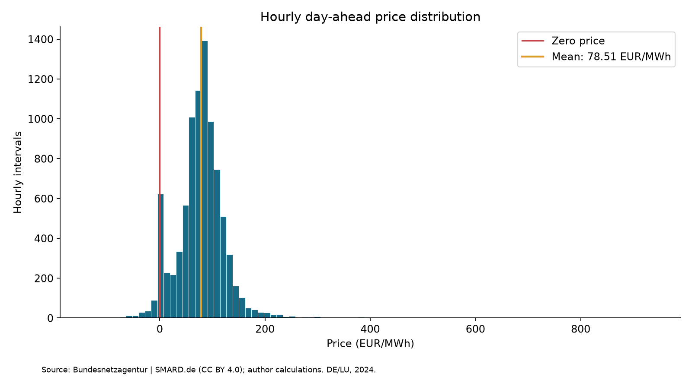
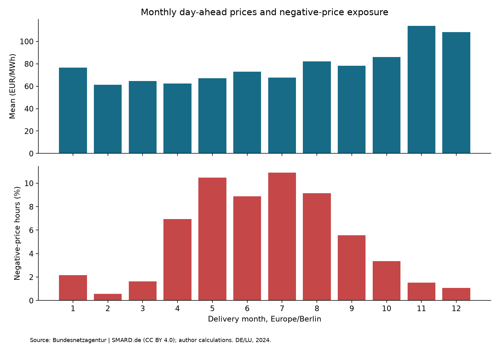
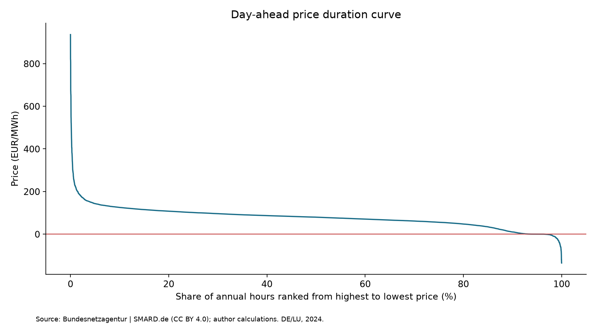

# German Electricity Market Baseline — 2024

Version 0.1 | Analysis reviewed: 28 October 2026

## Research role and scope

This first electricity-market baseline uses hourly day-ahead prices for the Germany/Luxembourg bidding zone (DE/LU) during calendar year 2024 in Europe/Berlin time. It supports the project's German market focus; it is not a Europe-wide market study or a forecast for 2035–2050. 2024 was selected as a complete hourly year with regulator-published statistics against which the calculations can be checked. This choice does not imply that more recent complete-year data do not exist.

The snapshot was retrieved on 28 October 2026. Delivery dates are historical; retrieved series can incorporate later data revisions. Do not claim this is the exact data vintage available at the project's 24 October evidence cutoff. A strict cutoff-vintage study would require an archived as-of dataset. No contemporary company event after the cutoff is introduced by this analysis.

## Sources and attribution

Source: **Bundesnetzagentur | SMARD.de**, hourly market-price series 4169, API region code DE, representing the Germany/Luxembourg bidding zone. Upstream market data are supplied through ENTSO-E. The raw weekly JSON blocks and index are retained with URLs and SHA-256 hashes in data/raw/smard_2024/manifest.json.

Market data are supplied under **CC BY 4.0**: https://creativecommons.org/licenses/by/4.0/. Data-use statement: https://www.smard.de/en/datennutzung. Author modifications comprise selecting local delivery year 2024, normalization to CSV, statistical aggregation and visualization. Figures carry the required attribution.

The historical official comparison is [SMARD's 2024 review](https://www.smard.de/page/en/topic-article/5892/215704/evaluation-of-last-year). SMARD notes an exchange-specific exception on 26 June 2024: partial market decoupling produced EPEX prices not reflected in its series, which used prices delivered from unaffected exchanges. Results here describe the SMARD series and should not be presented as every exchange's transaction outcome.

## Data quality and time handling

The selection interval is [2024-01-01 00:00 Europe/Berlin, 2025-01-01 00:00 Europe/Berlin). Timestamps are stored in UTC with a timezone-aware local representation. This preserves the missing spring clock hour and repeated autumn clock hour correctly. There are 8,784 consecutive one-hour intervals, no duplicate UTC timestamps and no missing/non-finite prices. Negative prices are retained. No missing-value imputation or outlier clipping is performed.

This code is deliberately restricted to this hourly 2024 baseline. It must not be used unchanged for quarter-hour or mixed-resolution price series. Its time-grid checks intentionally reject incompatible data.

## Definitions and equations

Let p_t denote EUR/MWh and d_t interval duration in hours. The time-weighted mean is sum(p_t*d_t)/sum(d_t). Negative-price share is sum(d_t for p_t<0)/sum(d_t). All durations in this dataset are one hour; these simplify to the arithmetic mean and the negative-interval count divided by 8,784. Zero-price intervals are not negative-price intervals.

Reported standard deviation measures dispersion of hourly price LEVELS, using population normalization (ddof=0). It is not volatility of investment returns or a forecast uncertainty parameter. Log returns are inappropriate as a routine transformation here because prices can be zero or negative. Percentiles use NumPy's default linear interpolation.

A generator's capture price is sum(p_t*E_t)/sum(E_t), with E_t its electricity output in MWh during interval t. This equals the time-weighted market average only under the relevant constant-output/weighting assumptions. Availability, maintenance, curtailment and contracts can change realized revenues. No generation profile is assumed or modeled here.

## Calculated results

| Measure | Result |
|---|---:|
| Covered hourly intervals | 8,784 |
| Time-weighted mean | 78.51 EUR/MWh |
| Median | 79.59 EUR/MWh |
| Population standard deviation of price levels | 52.72 EUR/MWh |
| 5th percentile | -0.01 EUR/MWh |
| 95th percentile | 143.25 EUR/MWh |
| Minimum | -135.45 EUR/MWh |
| Maximum | 936.28 EUR/MWh |
| Negative-price hours | 457 |
| Negative-price share | 5.20% |
| Hours above 100 EUR/MWh | 2,296 |
| Longest consecutive negative-price spell | 18 hours |

The mean, extrema, negative-hour count and >100 EUR/MWh hour count agree with the regulator's published historical review. The additional distribution and run-length metrics are author calculations from the retained raw data, not independently published regulator statistics.

## Figures

The duration curve ranks hours by price and therefore removes chronology; it cannot establish the duration of consecutive negative spells. The monthly negative share is based on actual hours in each local month, accounting for daylight saving.

## Implications for later fusion economics

The historical mean provides market context, not a recommended future sales-price assumption or an LCOE competitiveness threshold. A future plant would face the prices and contracts of its own operating period. Being continuously available need not imply producing at full power in every interval; dispatch flexibility, minimum output, maintenance and operating costs require technical evidence.

For Stage 4, keep LCOE (discounted cost per discounted output) separate from market capture price and contracted revenue. For Stage 5, use transparent price and availability scenarios rather than treating this single year's dispersion as an empirically validated future distribution. Negative-price hours motivate questions about flexibility and offtake terms but do not prove that a given fusion architecture is commercially unsuitable.

## Data dictionary additions

- electricity_prices_de_lu_2024.csv: interval_start_utc (unique timezone-aware interval start), interval_start_local (Europe/Berlin with UTC offset), duration_hours (1.0), price_eur_mwh (signed numeric price), source_id (ES001).
- electricity_monthly_2024.csv: month (local YYYY-MM), mean_eur_mwh, hours (actual hourly interval count), negative_price_hours, negative_price_share_pct.
- electricity_summary_2024.json: annual metrics, with explicit units in field names. Percentiles and dispersion are price-level metrics.
- data/raw/smard_2024/: immutable snapshot for offline reproduction; manifest specifies URLs, hashes, attribution, access date and license.

## Reproduction and limits

Run python src/electricity_market_analysis.py from the project environment. Dependencies are pandas, numpy and matplotlib, already part of the project's core stack; timezone support requires Python 3.9+ with timezone data. Normal analysis does not require internet access. It verifies raw-file hashes, exact hourly coverage and the official historical checks before writing outputs.

The optional download_electricity_data.py refreshes the raw snapshot from the publicly served chart endpoint. That endpoint is an implementation dependency and may change; it is not claimed to be a stable documented API. Do not refresh the frozen snapshot merely to reproduce results. Preserve an old version if deliberately updating data. Official reference checks can legitimately fail after data revisions; investigate rather than deleting the checks.

This step provides a single-year empirical baseline, not a trend estimate, price forecast, causal study, fuel-price model, full-system-cost comparison or project valuation. Extension to other years is a separate analysis with appropriate interval and market-definition handling.
