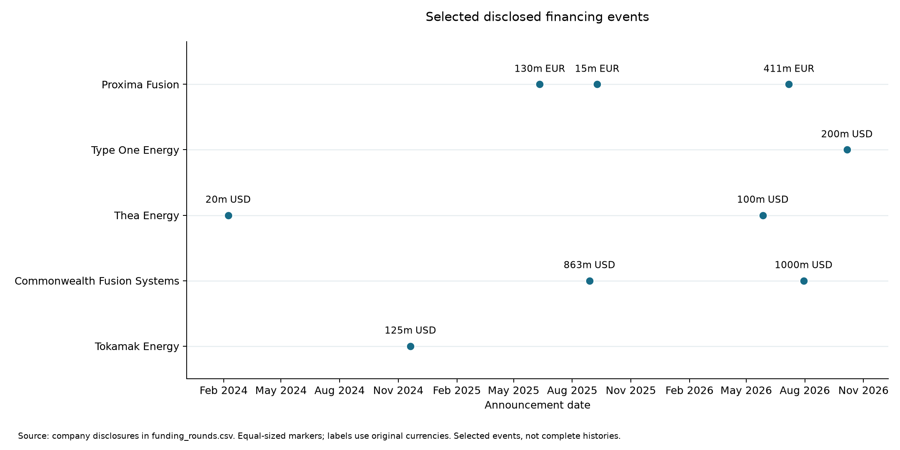
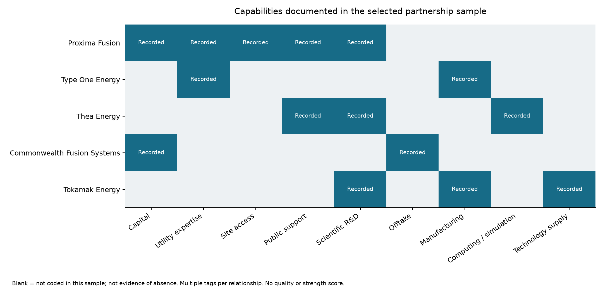
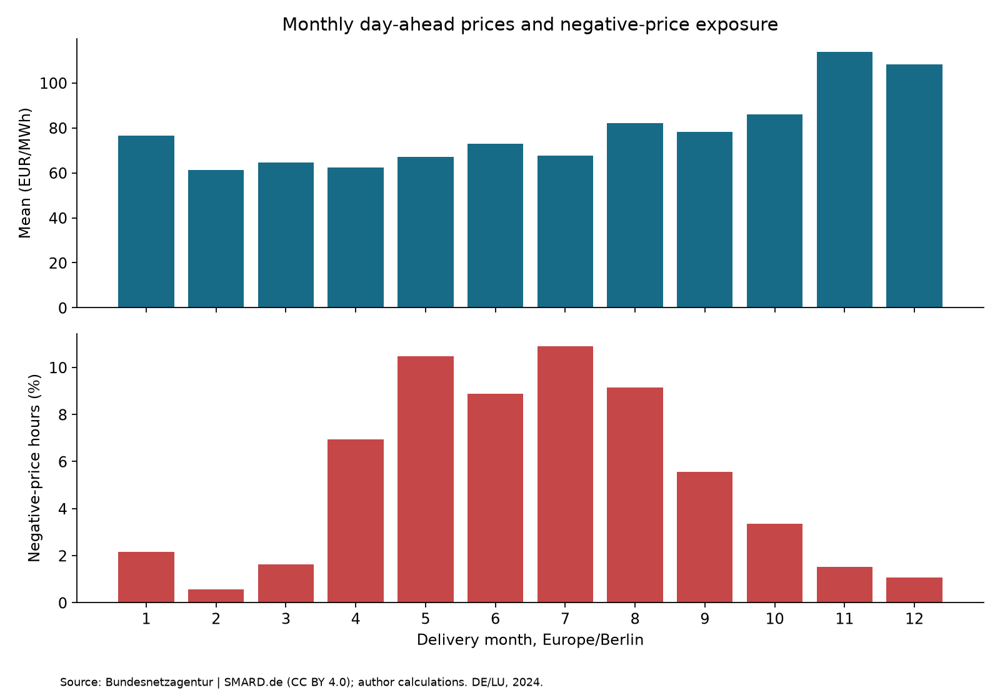

# Stage 1–2 Synthesis: Financing, Partnerships and Electricity-Market Context

*Generated from the current project inputs. Historical company-disclosure cutoff: 24 October 2026. This file is regenerated by src/integrate_stage12.py; make lasting factual edits in the input datasets and methodological edits in the script or source chapters.*

## 1. Research purpose and boundaries

The project asks how Proxima Fusion should position itself technologically, economically and strategically in Europe. This chapter establishes the descriptive evidence base for later technical benchmarking and economic scenarios. The five companies form a purposive case sample, not a representative census. See [research protocol](05_analysis_protocol.md) and [data dictionary](06_data_dictionary.md).

The evidence separates financing events from cumulative disclosures, company funding from project budgets, and announced relationships from demonstrated economic outcomes. It does not rank technical success from capital raised or partnership counts.

## 2. Financing: scope and event chronology

### Table 1. Coverage of selected financing events

| Company | Recorded events | First recorded event | Last recorded event |
| --- | --- | --- | --- |
| Commonwealth Fusion Systems | 2 | 2025-08-28 | 2026-07-30 |
| Proxima Fusion | 3 | 2025-06-11 | 2026-07-07 |
| Thea Energy | 2 | 2024-02-08 | 2026-05-27 |
| Tokamak Energy | 1 | 2024-11-20 | 2024-11-20 |
| Type One Energy | 1 | 2026-10-06 | 2026-10-06 |

These intervals describe the recorded sample, not a systematic search proving all events were captured. The timeline uses original-currency labels and equal-sized markers; no currency-equivalent funding ranking is encoded.

### Figure 1. Selected financing-event timeline

### Table 2. Historical cumulative disclosures

| Company | Reference date | Reported million | Currency | Scope | Qualifier | Review status | Evidence source |
| --- | --- | --- | --- | --- | --- | --- | --- |
| Proxima Fusion | 2026-07-07 | 650 | EUR | public_and_private | lower_bound | company_source_checked | [S001](https://www.proximafusion.com/press-news/proxima-fusion-raises-eu411-million-to-build-europes-commercial-fusion-champion) |
| Commonwealth Fusion Systems | 2026-07-30 | 4000 | USD | reported_capital_raised | approximate | company_source_checked | [S004](https://cfs.energy/news-and-media/commonwealth-fusion-systems-raises-another-1-billion-bringing-total-capital-raised-to-4-billion/) |
| Type One Energy | 2026-10-06 | 400 | USD | reported_total_funding | lower_bound | external_report_checked | [S010](https://www.ksl.com/article/51632922/fusion-firm-type-one-in-200-million-siemens-energy-backed-raise) |
| Thea Energy | 2026-05-27 | 130 | USD | private_investment | reported | external_report_checked | [S011](https://techcrunch.com/2026/05/27/with-a-new-100m-raise-princetons-thea-energy-is-now-a-top-funded-fusion-startup/) |
| Tokamak Energy | 2024-11-20 | 335 | USD | private_and_government | reported | company_source_checked | [S005](https://tokamakenergy.com/2024/11/20/tokamak-energy-raises-125m-to-commercialise-transformative-fusion-and-magnet-technologies/) |

Cumulative snapshots include their constituent rounds and must not be summed with them. Different reporting dates, public/private scope and qualifiers prevent a like-for-like financing ranking. An arithmetic residual between selected rounds and a cumulative disclosure does not identify a missing transaction. Lower bounds remain lower bounds; historic totals must not be labeled current without new evidence. See [funding audit](07_funding_audit.md); where its earlier review notes conflict with updated inputs, resolve the inconsistency before publication.

## 3. Partnerships: roles, commitment forms and unresolved terms

### Figure 2. Recorded contribution categories

Each colored cell indicates at least one recorded contribution in the selected sample. Blank cells mean not coded, not absent. The display is binary and does not rank quality, breadth of the full ecosystem, or realized commercial impact. One relationship can contribute several capabilities.

### Table 3. Partnership evidence matrix

| Company | Partner | Reported form | Documented contribution | Unresolved terms | Source |
| --- | --- | --- | --- | --- | --- |
| Proxima Fusion | RWE | equity_investment_reported | RWE reports EUR 25m invested in the company round; site and utility expertise also described. | Share subscription terms; control rights; site liabilities; quantified cost savings. | [S012](https://www.rwe.com/en/investor-relations/financial-calendar-and-publications/news-and-ad-hoc-announcements/news/news-2026-07-07/) |
| Proxima Fusion | Free State of Bavaria | conditional_cofinancing_indication | Bavaria indicated potential 20 percent co-financing subject to federal funding in the February MoU. | Subsequent approvals; disbursement; enforceable commitments; cost-overrun allocation. | [S013](https://proximafusion.com/press-news/proxima-fusion-rwe-the-free-state-of-bavaria-and-max-planck-institute-for-plasma-physics-sign-agreement-to-build-the-worlds-first-commercial-fusion-power-plant-in-europe) |
| Proxima Fusion | Max Planck IPP | mou_role_allocation | IPP assigned plasma-physics and scientific leadership; Proxima assigned engineering procurement and construction. | Detailed work packages; funding; IP ownership; performance liabilities. | [S013](https://proximafusion.com/press-news/proxima-fusion-rwe-the-free-state-of-bavaria-and-max-planck-institute-for-plasma-physics-sign-agreement-to-build-the-worlds-first-commercial-fusion-power-plant-in-europe) |
| Commonwealth Fusion Systems | Google | signed_ppa_reported | Google reports a 200 MW electricity PPA plus increased equity stake and options on future ARC output. | Power price; tenor; equity amount; termination rights; lender acceptance. | [S014](https://www.cfs.energy/news-and-media/google-and-commonwealth-fusion-systems-sign-strategic-partnership/) |
| Commonwealth Fusion Systems | Eni | signed_ppa_reported | Eni and CFS announced a power offtake agreement worth more than USD 1bn. | Delivery profile; price; duration; payment timing; guarantees and termination rights. | [S015](https://cfs.energy/news-and-media/eni-and-commonwealth-fusion-systems-sign-1-billion/) |
| Type One Energy | Tennessee Valley Authority | signed_service_contracts_reported | TVA Power Service Shops to assist tailored welding and fabrication under signed commercial contracts. | Fees; contractual liabilities; acceptance tests; allocation of delay and overrun costs. | [S016](https://typeoneenergy.com/insights-announcements/tva-type-one-energy-sign-first-contracts-fusion-power-plant-project/) |
| Thea Energy | NVIDIA | collaboration_announced | NVIDIA to support integration of models codes and data into the digital twin platform. | Commercial terms; compute costs; data rights; deliverable acceptance; measured savings. | [S017](https://thea.energy/press-release/thea-energy-accelerates-fusion-energy-with-helios-power-plant-digital-twin-and-ai-surrogate-models-in-collaboration-with-nvidia-synopsys-argonne-national-laboratory-and-princeton-plasma-physics-lab/) |
| Thea Energy | Princeton Plasma Physics Laboratory | collaboration_announced | PPPL to contribute plasma-modeling knowledge and high-fidelity computational tools. | Scope and ownership of delivered models; funding; liabilities; realized benefits. | [S017](https://thea.energy/press-release/thea-energy-accelerates-fusion-energy-with-helios-power-plant-digital-twin-and-ai-surrogate-models-in-collaboration-with-nvidia-synopsys-argonne-national-laboratory-and-princeton-plasma-physics-lab/) |
| Tokamak Energy | UK Fusion Energy | contract_award_reported | UKFE awarded GBP 70m for magnet systems work packages through March 2029. | Payment milestones; recognized revenue; margin; warranty and performance liabilities. | [S018](https://tokamakenergy.com/2026/04/14/tokamak-energy-named-magnet-systems-partner-for-step-fusion-programme/) |
| Tokamak Energy | Gauss Fusion | signed_collaboration_reported | Tokamak Energy and Gauss Fusion announced a signed HTS collaboration covering development integration and testing support. | Contract value; exclusivity; IP rights; deliverables; liabilities. | [S019](https://tokamakenergy.com/2025/10/07/tokamak-energy-signs-strategic-hts-collaboration-with-gauss-fusion/) |
| Thea Energy | US Department of Energy INFUSE | award_selection_reported | Thea reported selection for three INFUSE awards involving two PPPL collaborations and one Columbia collaboration. | Award amounts; payment recipient and timing; detailed terms; realized outcomes. | [S020](https://thea.energy/press-release/thea-energy-selected-for-three-u-s-department-of-energy-public-private-partnership-awards-through-the-innovation-network-for-fusion-energy-program/) |

An investment, conditional public indication, PPA, service contract and award selection create different obligations. The publicly reported agreement form is not a legal enforceability opinion. Undisclosed prices, liabilities and termination terms remain unknown. Potential reductions in funding burden or execution risk remain mechanisms for later scenario analysis, not established causal results. See [partnership methodology](09_partnership_evidence_analysis.md).

## 4. Development chronology: reported events versus targets

### Table 4. Selected historical milestone observations

| Company | Project | Event / target | Statement date | Target period | Exact event date | Reported state | Source |
| --- | --- | --- | --- | --- | --- | --- | --- |
| Proxima Fusion | SMC | Complete Stellarator Model Coil | 2025-06-11 | 2027 |  | planned | [S006](https://proximafusion.com/press-news/proxima-fusion-raises-eu130m-series-a-to-build-worlds-first-stellarator-based-fusion-power-plant-in-the-2030s) |
| Proxima Fusion | Alpha | Begin Alpha operations | 2025-06-11 | 2031 |  | planned | [S006](https://proximafusion.com/press-news/proxima-fusion-raises-eu130m-series-a-to-build-worlds-first-stellarator-based-fusion-power-plant-in-the-2030s) |
| Type One Energy | Project Infinity | Submit initial byproduct material license application | 2026-01-29 |  |  | reported_completed | [MS001](https://typeoneenergy.com/insights-announcements/type-one-energy-initial-licensing-application-bull-run/) |
| Type One Energy | Infinity One | Commission and start Infinity One | 2026-01-29 | 2029 |  | planned | [MS001](https://typeoneenergy.com/insights-announcements/type-one-energy-initial-licensing-application-bull-run/) |
| Commonwealth Fusion Systems | SPARC | Receive second half of SPARC vacuum vessel | 2026-05-14 |  |  | reported_completed | [MS002](https://blog.cfs.energy/cfs-begins-preparing-a-home-for-our-100-million-degree-fusion-plasma/) |
| Commonwealth Fusion Systems | SPARC | Begin SPARC operations | 2026-05-14 | 2027 |  | planned | [MS002](https://blog.cfs.energy/cfs-begins-preparing-a-home-for-our-100-million-degree-fusion-plasma/) |
| Thea Energy | Helios | Announce publication of Helios design paper series | 2026-09-09 |  | 2026-09-09 | reported_completed | [MS003](https://thea.energy/press-release/thea-energy-publishes-the-most-practical-fusion-power-plant-design-and-a-clear-path-toward-energy-on-the-grid/) |
| Thea Energy | Helios | Operate Helios | 2026-09-09 | 2030s |  | planned | [MS003](https://thea.energy/press-release/thea-energy-publishes-the-most-practical-fusion-power-plant-design-and-a-clear-path-toward-energy-on-the-grid/) |
| Tokamak Energy | Demo4 | Complete Demo4 magnet test campaign | 2026-09-09 |  |  | reported_completed | [MS004](https://tokamakenergy.com/2026/09/09/tokamak-energy-completes-world-leading-fusion-magnet-campaign-validating-technology-for-commercial-hts-systems/) |

Statement dates must not silently become exact event dates. reported_completed records a party's account, not independent verification. Year-only or decade-level targets retain their precision; older schedules are historical observations rather than latest forecasts. This sparse register cannot establish comparative delay rates or technical readiness. See [milestone methodology](08_milestone_methodology.md).

## 5. Electricity-market context

The first empirical baseline covers 2024 DE/LU hourly day-ahead prices. The raw dataset was retrieved in October 2026 and can contain revisions; it is not an archived October 24 vintage. The observations below are author calculations from the retained SMARD series, attributed to Bundesnetzagentur | SMARD.de under CC BY 4.0.

| Measure | 2024 result |
| --- | --- |
| Covered hours | 8784 |
| Mean price | 78.51 EUR/MWh |
| Median price | 79.59 EUR/MWh |
| Negative-price hours | 457 |
| Negative-price share | 5.20% |

### Figure 3. Monthly prices and negative-price exposure

The time-weighted market mean is not a future sales-price assumption or an LCOE competitiveness threshold. A plant's capture price weights prices by its actual production. Availability, dispatch flexibility and contracts therefore belong in later revenue scenarios. No future distribution is calibrated from this single year's price dispersion. See [electricity baseline](10_electricity_market_baseline.md) for all three price figures, equations, source links, exchange-specific limitations and quality checks.

## 6. Implications for the research hypotheses

| Hypothesis | What this chapter contributes | What remains to be evaluated |
|---|---|---|
| H1 — Technology economics | Historical market context and explicit distinction between generation cost and realized price | Technical parameters, FOAK/NOAK costs, availability, financing and future revenue scenarios |
| H2 — Partnerships | Source-linked contributions and explicit missing contract terms | Allocation of capital, liabilities, retained value and control under defined alternatives |
| H3 — Manufacturing scalability | Recorded manufacturing and technology-supply relationships | Repeatable component costs, learning assumptions, redesign needs and deployment scale |

None of the three hypotheses is validated by descriptive funding or partnership records. Stage 3 must inspect engineering and business-model evidence before subsequent models translate it into costs, output and risk assumptions.

## 7. Data consistency and open issues

No snapshot/claim status mismatches or pending financing claims were detected by these checks. This is not a certification of factual completeness.

The enhanced dataset remains selected and historical. Source review is not audited financial assurance. Missing values, party claims and modeling assumptions must remain distinct. The checks below do not establish exhaustive research coverage or independently demonstrated technological performance.

## 8. Reproduction and document ownership

Run python src/electricity_market_analysis.py before this integration script when refreshing the electricity outputs. Then run python src/integrate_stage12.py. The script generates this chapter, two new figures, data/all_claims.csv and data/all_claim_sources.csv. The combined claim files are derived unions; edit the financing and partnership source tables instead. Existing chapters and original data files are preserved.

This generated chapter is the consolidated Stage 1–2 reading entry point. Keep research/03_market_financing_analysis.md as the detailed financing chapter and the numbered audit/methodology notes as supporting documentation. No automatic replacement of their manually edited text is performed. Final editorial consolidation and publication review remain part of the final report stage.
